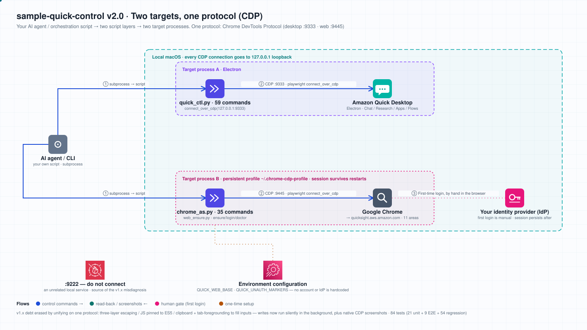

<div align="center">


# 🎛️ sample-quick-control

**Drive Amazon Quick on macOS programmatically — desktop app *and* web, one protocol (CDP)**

[](https://github.com/aws-samples/sample-quick-control/actions/workflows/ci.yml)
[](./LICENSE)
[](https://www.python.org)
[](https://github.com/astral-sh/uv)

[](./tests)

**English** · [简体中文](./README.zh-CN.md)

If you can click it in the Amazon Quick UI, you can automate it: send messages, read replies, generate dashboards, build apps, build flows, run deep research, manage spaces and dashboards.

</div>

> [!WARNING]
> **Sample code — not for production.**
> This repository is AWS sample code for demonstration and learning. It is provided **as is**, with no SLA and no backwards-compatibility promise.
> It drives **the real, already-signed-in application on your own machine** over the Chrome DevTools Protocol, which means:
> - Automated actions **really happen** (creating a space, deleting a space, publishing an app are all real). Run it against a throwaway or test account first.
> - Opening a CDP debug port means **any local process that can reach that port can control that browser instance**. This project binds to the loopback address `127.0.0.1` only — do not change it to `0.0.0.0` and do not expose it.
> - UI automation depends on UI structure by nature. When the Amazon Quick front end changes, selectors may break and need re-probing.
> - Before any production use, do your own security review, least-privilege scoping, and error-handling hardening.

> [!NOTE]
> **Language of the CLI output.** Command names, flags, exit codes, and the JSON contracts are English and stable. The human-readable messages the scripts print to stdout/stderr are currently **Simplified Chinese** (for example `✓ 已切换 feed 源`, `⚠️ 尚未登录`). If you script against these tools, branch on **exit codes and JSON fields**, not on message text.

---

## 🏗️ Architecture: two targets, one protocol (CDP)



An orchestrator (Claude Code, your own Python script, a CI job) remote-controls two **target processes**. The protocol is Chrome DevTools Protocol in both cases; only the process and the port differ:

| Target | Process | Mechanism | Script |
|---|---|---|---|
| 🟢 **Desktop** | Amazon Quick Desktop (Electron) | CDP, debug port `:9333` | `quick_ctl.py` |
| 🟢 **Web** | Google Chrome → Amazon Quick on the web | CDP, dedicated persistent profile `~/.chrome-cdp-profile`, debug port `:9445` | `chrome_as.py` + `web_ensure.py` |

**What each port is** (don't connect to the wrong one):

| Port | What it is | Used for |
|---|---|---|
| `:9333` | CDP of the Quick Electron app | Desktop channel (override with `QUICK_CDP_PORT`) |
| `:9445` | CDP of the dedicated persistent-profile Chrome | Web channel (override with `QUICK_WEB_CDP_PORT`) |
| anything else | **A local service that has nothing to do with DevTools** | **Do not connect** — a LISTENing port is *not* proof of a DevTools endpoint; see gotcha #2 below |

The full path from nothing to a drivable web channel — including the **human gate** (the first login) — is in the control-flow diagram:



**Why the web channel uses its own persistent profile**: CDP requires `--remote-debugging-port`, and your everyday browser normally doesn't run with that port open — nor should you restart it just for automation. A dedicated `--user-data-dir` keeps the debug instance and your main browser out of each other's way, while persisting the login cookie in that directory — so **you log in by hand exactly once**, and every later `ensure` is idempotent.

---

## ✨ What it can do

- 🖥️ **59 desktop commands**: chat / history / model and thinking effort / attachments / navigation / settings / Activity feed / Agents / Mission Control / connectors / per-message actions
- 🗣️ **Natural-language triggers**: Research deep dives, one-sentence app generation, scheduled Flows, chat agents
- 🌐 **35 web commands**: navigate the 11 areas, search, filter, sort, paginate, create and delete spaces, create / edit / publish / share apps, native CDP screenshots
- 📟 **Callable from higher-level scripts**: every script is a self-contained CLI, so `subprocess` is all you need to compose them into any playbook

---

## ✅ Prerequisites

| Requirement | Notes |
|---|---|
| **macOS** | Depends on the fixed paths `/Applications/Amazon Quick.app` and `/Applications/Google Chrome.app`, and on launching local processes with a debug port |
| **Amazon Quick** | Desktop app installed under `/Applications/`; the web channel needs a Quick account you have access to |
| **`uv`** | Python package manager ([install](https://github.com/astral-sh/uv)). This project always uses `uv run` — never bare `pip` / `python` |
| **playwright** | `uv run --with playwright python -m playwright install chromium`. Both channels attach to an **already-running local instance** (Electron / real Chrome), so the downloaded Chromium isn't used — but the package has to be there |
| **Python ≥ 3.10** | The `requires-python` floor in `pyproject.toml`; CI runs on both 3.10 and 3.13 |
| **An account you can sign in to** | The first time you run `web_ensure.py login`, **sign in by hand** in the Chrome window that opens. This project does not sign in for you and never touches or stores credentials |

### Environment variables (all optional, all defaulted)

| Variable | Default | Purpose |
|---|---|---|
| `QUICK_CDP_PORT` | `9333` | CDP port of the Quick desktop app |
| `QUICK_WEB_CDP_PORT` | `9445` | CDP port of the web-channel Chrome |
| `QUICK_WEB_PROFILE` | `~/.chrome-cdp-profile` | Dedicated persistent profile directory for the web channel (this is where the session lives) |
| `QUICK_WEB_REGION` | `us-east-1` | Region your Quick web instance is in |
| `QUICK_WEB_ACCOUNT` | `your-quick-account` (placeholder) | **Your Quick account name.** No real account is baked into the code — you must set this before using the web channel |
| `QUICK_WEB_BASE` | composed from the two above | Override the whole start-URL prefix (setting this ignores region/account) |
| `QUICK_UNAUTH_MARKERS` | `signin,login,authorize,oauth,sso` | Comma-separated URL markers that mean "signed out"; matching any one of them counts as signed out. Identity-provider domains differ per organization, so override as needed |

```bash
# Typical setup: point at your own account and region
export QUICK_WEB_REGION=us-east-1
export QUICK_WEB_ACCOUNT=my-quick-account

# Or override the start URL wholesale (trailing slash optional — the code normalizes it)
export QUICK_WEB_BASE=https://us-east-1.quicksight.aws.amazon.com/sn/account/my-quick-account/start

# If your sign-in redirect domain isn't covered by the defaults, add your own keyword
export QUICK_UNAUTH_MARKERS=signin,login,authorize,oauth,sso,my-idp
```

> An empty or whitespace-only `QUICK_UNAUTH_MARKERS` **falls back to the default** rather than silently disabling the signed-in check.

---

## 🚀 Quick start

```bash
git clone https://github.com/aws-samples/sample-quick-control.git
cd sample-quick-control/scripts

# ── Desktop: make sure it runs with the debug port → ask a question → screenshot ──
uv run --with playwright python quick_ctl.py ensure
uv run --with playwright python quick_ctl.py ask "Analyze the anomalies in this revenue data"
uv run --with playwright python quick_ctl.py screenshot /tmp/q.png

# ── Web: one command brings up the persistent-profile instance ──
export QUICK_WEB_ACCOUNT=my-quick-account       # set this to your own account first
uv run python web_ensure.py ensure              # idempotent: returns immediately if already running
uv run python web_ensure.py login               # first time: sign in by hand in the window that opens
uv run python web_ensure.py doctor              # two checks: CDP port / signed-in state
uv run python web_ensure.py status              # JSON: cdp_ok / signed_in / url / tabs / port / profile

# ── Drive the web channel (the session persists; restarting the instance needs no re-login) ──
uv run --with playwright python chrome_as.py goto spaces
uv run --with playwright python chrome_as.py list
uv run --with playwright python chrome_as.py search "quarterly revenue"
uv run --with playwright python chrome_as.py screenshot /tmp/web.png
```

`web_ensure.py` has five commands: `ensure` (idempotently get the channel ready) / `status` (JSON state) / `login` (wait for you to sign in) / `doctor` (health check plus fix suggestions) / `restart` (restart the instance after changing the port or clearing state).

> **Writes have guardrails**: destructive commands require explicit confirmation. For example `chrome_as.py delete-space` without `--confirm` refuses to run and exits with code 2.

---

## 📦 Optional: install as a Claude Code Skill

This project has a **dual identity**: it is a standalone set of CLI tools, and it is also a Claude Code Skill (declared through the frontmatter in `SKILL.md`). Installing it means **symlinking the repository into `~/.claude/skills/`**:

```bash
# 1. Clone wherever you keep code (any path works)
git clone https://github.com/aws-samples/sample-quick-control.git ~/Code/sample-quick-control

# 2. Symlink it into the skills directory
#    ⚠️ The directory name must match the `name` in SKILL.md's frontmatter (currently amazon-quick-control)
ln -s ~/Code/sample-quick-control ~/.claude/skills/amazon-quick-control

# 3. Verify
ls -la ~/.claude/skills/amazon-quick-control
```

- **Why a symlink instead of a copy**: edit the code in the repo and the skill picks it up **immediately** — no reinstall, no two copies to keep in sync.
- **When changes take effect**: the body of `SKILL.md` is read on every invocation, so edits apply instantly. But the **`name` / `description` in the frontmatter are loaded at startup** — change a trigger phrase and you need to restart Claude Code.
- **Just want the plain CLI?** Skip step 2. The `scripts/*.py` files are self-contained; run them with `uv run` directly.
- Note that `SKILL.md` itself is written in Chinese, since its trigger phrases are Chinese.

---

## 📂 The scripts

| Script | What it does |
|---|---|
| `quick_ctl.py` | Desktop CDP control, **59 commands** (chat / history / model / attachments / navigation / settings / message actions / wait strategies), port `:9333` |
| `chrome_as.py` | Web CDP control, **35 commands** (navigate / perceive / click / fill / read lists / screenshot / create and delete spaces / create and publish apps), port `:9445` |
| `web_ensure.py` | Bring-up and self-healing for the web channel: `ensure` / `status` / `login` / `doctor` / `restart` |
| `map_screen.py`, `crawl_all.py` | UI element harvesting (one screen / a walk across the desktop screens), dumped to `/tmp/quickmap/*.json` |
| `crawl_web_deep.py`, `probe_web_areas.py` | Harvesting and probing of the 11 web areas — ⚠️ still an early implementation, **not yet migrated to CDP**, pending rework |
| `probe_settings.py` | Probes the desktop settings screens |
| `verify_all.py` | Exercises every desktop capability in a single session and prints a PASS/FAIL report |

---

## 🧪 Tests

```bash
uv run --with pytest --with playwright --with 'ruff>=0.12,<0.13' python -m pytest tests/ -v
```

Three layers, **84 tests** in total. What you see depends on what's running locally: with the Quick desktop app up, this machine reports 79 passed / 5 skipped (the 5 skips need a signed-in web channel); with no local Quick at all, 76 passed / 8 skipped.

- **Unit** (`test_unit.py`, 21 tests): the 11-area alias mapping; completeness of the `_VIEW_MAP` / `_FILTER_MAP` / `_PAGE_MAP` tables; `WEB_BASE` URL composition and `QUICK_WEB_ACCOUNT` resolution; CDP endpoints being loopback-only; the `status` JSON contract; the persistent profile being distinct from your main profile; the signed-in test and `QUICK_UNAUTH_MARKERS` override behaviour — **no real machine required**
- **E2E** (`test_e2e.py`, 9 tests): 3 desktop (`status` / port / `read`) plus 6 web (`cdp_ok` / `signed_in` in `status`, signed-in state, the `goto`+`list` read path, native CDP screenshots, soft failure exiting 0, `delete-space` without `--confirm` exiting 2) — **auto-skipped when the channel isn't ready; all read-only, creates no assets**
- **Regression** (`test_regression.py`, 54 tests): all 9 scripts parsed at the `requires-python` floor (`ast.parse(feature_version=)`), plus a `ruff --isolated --target-version py310 --select E9` syntax gate as a backstop, plus **a contract guardrail for each of the 35 web commands** (dispatch checked via AST, so it isn't pinned to one coding style), plus `--confirm` actually gating (AST-checked for `sys.exit`), plus port conventions staying consistent

> Real-machine tests decide their skips by probing the channels in `tests/conftest.py`. **The key point**: the probe must **verify that the discovery layer really responds** (`/json/version`) rather than merely checking that a port is LISTENing — a port that's open but isn't DevTools is a real situation, and port-only probing gets it wrong. Ports are read from `QUICK_WEB_CDP_PORT` / `QUICK_CDP_PORT`, the same source the scripts under test use, so changing a port doesn't produce false reds.
>
> The signed-in test in the suite comes from **the same source** as `web_ensure.unauth_markers()` (conftest imports it directly) instead of keeping a second copy, so the two can't drift apart.

### CI (GitHub Actions, `.github/workflows/ci.yml`)

The runner has neither the Quick desktop app nor a CDP Chrome, so pytest **runs in two steps**, each asserting something different:

| Step | Command gist | Expectation |
|---|---|---|
| No-real-machine layer | `-m "not realmachine"` | **All pass / 0 skipped** — any skip here means a guardrail was silenced |
| Real-machine layer | `-m realmachine` | **All skipped / exit 0** — this step *is* the regression test for the conftest skip logic |

- The workflow hardcodes `QUICK_CDP_PORT=59333` / `QUICK_WEB_CDP_PORT=59445` (ports nothing listens on), so a stray service occupying 9333/9445 on the runner can't "wake up" the real-machine tests and fail them.
- There are two lint jobs: `ruff check .` (pinned to `ruff>=0.12,<0.13`, the same range as `pyproject.toml`, to avoid rule drift) and the `ruff --isolated --target-version py310 --select E9` syntax gate (`--isolated` bypasses the pyproject ignores, so tuning that ignore list can't get around it).
- The pytest matrix covers **3.10 and 3.13**: 3.10 is the floor declared by `requires-python`, and incompatibilities like a backslash inside an f-string **only surface on 3.10**.
- ⚠️ The pytest step must include `--with 'ruff>=0.12,<0.13'` — `test_min_python_syntax_gate` uses `shutil.which("ruff")` in its skipif, so without ruff on `PATH` it **skips silently** and CI goes falsely green.
- There is also a hygiene job: a scan for credential-shaped strings, plus a consistency check between the version in `pyproject.toml` and the top version in `CHANGELOG.md`.

---

## ⚠️ Gotchas (learned the hard way)

<details>
<summary><b>Expand 8 field notes</b></summary>

1. **Debug ports only open at launch**: a running Chrome / Electron cannot have a debug port attached hot — it must be restarted with `--remote-debugging-port`. `quick_ctl.py ensure` handles that for the desktop; the web side launches with a persistent profile plus `--remote-debugging-port=9445`.
2. **A LISTENing port is not a DevTools endpoint**: some local service listening on a port does not make it DevTools. We once read "the process wasn't launched with debug flags + an unrelated service holds the port" as "corporate policy blocks DevTools", and on the strength of that misreading locked the entire web channel into a convoluted workaround for nearly a release cycle. **Correct order of investigation: confirm the target process's launch flags first, and only then talk about external blocking.** Use `GET /json/version` returning browser info as the test — not `lsof`.
3. **Single-session discipline**: on a real machine there is one browser instance and one session. **Do not drive it concurrently** — prefer reads, one action at a time. If you want parallelism, parallelize "analyzing data you already dumped".
4. **The i18n trap in delete confirmations**: the delete-space dialog asks you to type `Delete`, but what it actually validates is the localized word (in a Chinese UI, 「删除」). Confirmation words for deletions must match the UI language — don't copy the English prompt verbatim.
5. **Artifact generation has long silent stretches**: while Quick builds a dashboard and runs code, the UI emits no text, so a "text has stabilized" heuristic declares completion too early. Use `wait-done` (watch for the Stop button to disappear) plus a fixed buffer. **Reliable >> fast.**
6. **SPA timing**: text appearing ≠ the element being interactive (table rows and buttons mount later). Every click and row lookup uses self-retrying polling, not a fixed `sleep`.
7. **Screen-recording permission**: without the "Screen Recording" permission, a terminal's `screencapture` fails with `could not create image from display`. CDP is more direct: `page.screenshot()` **doesn't need Screen Recording permission at all**.
8. **Three traps with playwright over CDP**: don't call `b.new_page()` (it raises `Browser context management is not supported`); reuse the page inside `b.contexts[0]` whose URL matches the target site; open new tabs through the CDP HTTP endpoint `PUT /json/new?<url>`.

**Historical constraints from the early AppleScript implementation — gone since the move to CDP** (kept for the record):

- **Never hand-assemble JS inside a shell heredoc**: shell / AppleScript / JS made **three layers of escaping hell**. Arrow functions `=>`, spread `...`, `<`, `\s`, or a curly quote misplaced in any one layer produced a `syntax error`; back then all JS was forced down to ES5.
  → Over CDP, `page.evaluate` takes a function object directly. There is no escaping layer, modern JS works as measured, and the ES5 constraint is void.
- **Rich front-end components resisted automation → the clipboard hack**: the confirmation box is a controlled input component, and pure JS injection (`nativeSetter` / `_valueTracker` / synthetic event chains) was **entirely ineffective**. The only working answer back then was `pbcopy` + bringing the tab to the foreground + `Cmd+A`/`Cmd+V`.
  → Over CDP, playwright's native `locator.fill()` **writes straight in**, as measured. The clipboard hack and the must-be-foregrounded requirement both retired together.

</details>

---

## 🧹 Cleanup

This project creates no cloud resources; cleanup is entirely local:

```bash
# 1. Kill the debug Chrome instance (only the one on this dedicated profile — your main browser is untouched)
pkill -f "user-data-dir=$HOME/.chrome-cdp-profile"

# 2. Delete the persistent profile directory (it holds the login cookie — you'll sign in again next time)
rm -rf ~/.chrome-cdp-profile

# 3. Dumps produced by the harvesting scripts
rm -rf /tmp/quickmap

# 4. If you installed it as a Claude Code Skill, remove the symlink (this does not delete your clone)
rm ~/.claude/skills/amazon-quick-control

# 5. Delete the clone itself
rm -rf ~/Code/sample-quick-control
```

> The Quick desktop app is your own application — quit it however you normally would. This project changes none of its persisted settings, except when you explicitly call a `set-*` command.

---

## 🔐 Security

- **Never touches credentials**: this project does not read, store, or transmit any username / password / token / cookie. Signing in is done entirely by you, by hand, in the browser window that opens; the session is persisted by that profile directory itself.
- **Loopback only**: every CDP connection goes to `127.0.0.1`, guarded by a unit test (`test_cdp_endpoint_uses_loopback`). **Do not** bind the debug port to `0.0.0.0` or forward it to the internet — that hands over control of the browser.
- **The persistent profile directory holds a live session**: `~/.chrome-cdp-profile` contains session cookies. Treat it as sensitive data (don't back it up to a public repo, don't hand it to anyone else), and delete it via the Cleanup section when you're done.
- **Destructive operations require explicit confirmation**: delete commands must carry `--confirm` or they refuse to run.
- **Don't put secrets in `QUICK_WEB_*`**: these variables are only a region / account name / URL prefix, and they show up in process listings and logs.
- Report security issues as described in [SECURITY.md](./SECURITY.md) (please do **not** open a public issue).

---

## 🤝 Contributing

Contributions are welcome — please read [CONTRIBUTING.md](./CONTRIBUTING.md) first. Participation in this project is governed by [CODE_OF_CONDUCT.md](./CODE_OF_CONDUCT.md).

---

## 📜 License

This project is licensed under **MIT-0** — see [LICENSE](./LICENSE). Release history is in the [CHANGELOG](./CHANGELOG.md).
</content>
