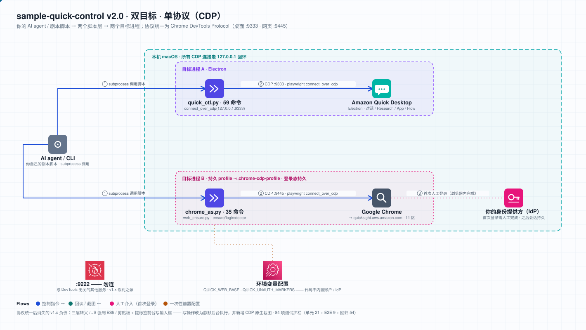

<div align="center">


# 🎛️ sample-quick-control

**程序化控制 macOS 上的 Amazon Quick —— 桌面端 + 网页版，统一 CDP 驱动**

[](https://github.com/aws-samples/sample-quick-control/actions/workflows/ci.yml)
[](./LICENSE)
[](https://www.python.org)
[](https://github.com/astral-sh/uv)

[](./tests)

[English](./README.md) · **简体中文**

凡 Amazon Quick 界面能点的，都能程序化自动化：发消息 / 收回复 / 生成看板 / 建 App / 建 Flow / 深度研究 / 管理 Spaces & Dashboards。

</div>

> [!WARNING]
> **示例代码，不适用于生产环境（not for production）。**
> 本仓库是用于演示与学习的 AWS 示例代码，按「原样」提供，不含 SLA、不含向后兼容承诺。
> 它通过 **Chrome DevTools Protocol 驱动你本机上真实的、已登录的应用**，因此：
> - 自动化动作会**真实生效**（建空间、删空间、发布 App 都是真的），请先在一次性/测试账户里跑。
> - 打开 CDP 调试端口意味着**任何能访问该端口的本机进程都能控制那个浏览器实例**。本项目只绑定回环地址 `127.0.0.1`，请勿改成 `0.0.0.0` 或对外暴露。
> - UI 自动化天生依赖界面结构，Amazon Quick 前端改版后选择器可能失效，需要重新探测。
> - 用于生产前请自行完成安全评审、权限最小化与错误处理加固。

---

## 🏗️ Architecture 架构：双目标 · 单协议（CDP）



编排方（Claude Code、你自己的 Python 脚本、CI 任务）遥控两个**目标进程**，协议统一为 Chrome DevTools Protocol，差异只在进程与端口：

| 目标 | 进程 | 机制 | 脚本 |
|---|---|---|---|
| 🟢 **桌面端** | Amazon Quick Desktop（Electron） | CDP，调试端口 `:9333` | `quick_ctl.py` |
| 🟢 **网页版** | Google Chrome → Amazon Quick 网页版 | CDP，独立持久 profile `~/.chrome-cdp-profile`，调试端口 `:9445` | `chrome_as.py` + `web_ensure.py` |

**端口分工**（别连错）：

| 端口 | 是什么 | 用途 |
|---|---|---|
| `:9333` | Quick Electron 的 CDP | 桌面端通道（`QUICK_CDP_PORT` 可改） |
| `:9445` | 独立持久 profile Chrome 的 CDP | 网页版通道（`QUICK_WEB_CDP_PORT` 可改） |
| 其他端口 | **与 DevTools 无关的本机服务** | **不要连** —— 端口 LISTEN ≠ 是 DevTools，判据见下方踩坑录第 2 条 |

网页版通道从零到可驱动的完整流程（含**人工介入点**：首次登录）见控制流程图：



**为什么网页版要用一个独立的持久 profile**：CDP 需要 `--remote-debugging-port`，而日常主浏览器通常不开这个端口，也不该为自动化去重启它。独立 `--user-data-dir` 让调试实例与你的主浏览器互不干扰，同时把登录 cookie 持久化在该目录里 —— **只需首次人工登录一次**，之后 `ensure` 都是幂等的。

---

## ✨ 能干什么

- 🖥️ **桌面端 59 个命令**：对话 / 历史 / 模型与思考强度 / 附件 / 导航 / 设置 / Activity feed / Agents / Mission Control / 连接器 / 消息级操作
- 🗣️ **自然语言触发**：Research 深度研究、Application 一句话生成 App、Flows 定时任务、Chat agents
- 🌐 **网页版 35 个命令**：11 区导航、搜索、筛选、排序、分页、建删空间、建/编辑/发布/分享 App、CDP 原生截图
- 📟 **可被上层脚本调用**：所有脚本都是自包含 CLI，`subprocess` 调用即可编排成任意剧本

---

## ✅ Prerequisites 必备条件

| 条件 | 说明 |
|---|---|
| **macOS** | 依赖 `/Applications/Amazon Quick.app` 与 `/Applications/Google Chrome.app` 的固定路径，以及在本机直接拉起进程加调试端口 |
| **Amazon Quick** | 桌面端已装于 `/Applications/`；网页版需要一个你有权访问的 Quick 账户 |
| **`uv`** | Python 包管理（[安装](https://github.com/astral-sh/uv)）；本项目一律 `uv run`，不裸用 `pip` / `python` |
| **playwright** | `uv run --with playwright python -m playwright install chromium`。两条通道都连**本机已在跑的实例**（Electron / 真 Chrome），不需要下载的 Chromium，但包要在 |
| **Python ≥ 3.10** | `pyproject.toml` 的 `requires-python`；CI 在 3.10 与 3.13 双版本上跑 |
| **一个可登录的账户** | 首次跑 `web_ensure.py login` 时，在弹出的 Chrome 窗口里**手动登录**一次即可。本项目不代你登录、不接触也不存储任何凭证 |

### 环境变量（全部可选，均有默认值）

| 变量 | 默认值 | 作用 |
|---|---|---|
| `QUICK_CDP_PORT` | `9333` | 桌面端 Quick 的 CDP 端口 |
| `QUICK_WEB_CDP_PORT` | `9445` | 网页版 Chrome 的 CDP 端口 |
| `QUICK_WEB_PROFILE` | `~/.chrome-cdp-profile` | 网页版专用的持久 profile 目录（登录态存这里） |
| `QUICK_WEB_REGION` | `us-east-1` | Quick 网页版所在区域 |
| `QUICK_WEB_ACCOUNT` | `your-quick-account`（占位符） | **你的 Quick 账户名**。代码里不内置任何真实账户，跑网页版前必须设置 |
| `QUICK_WEB_BASE` | 由上面两项拼出 | 整体覆盖起始 URL 前缀（设了它就忽略 region/account 两项） |
| `QUICK_UNAUTH_MARKERS` | `signin,login,authorize,oauth,sso` | 「未登录页」的 URL 特征，逗号分隔；命中任一即判为未登录。不同组织的身份提供方域名不同，用它按需覆盖 |

```bash
# 典型配置：指定你自己的账户与区域
export QUICK_WEB_REGION=us-east-1
export QUICK_WEB_ACCOUNT=my-quick-account

# 或者直接整体覆盖起始 URL（结尾斜杠有无都行，代码会补齐）
export QUICK_WEB_BASE=https://us-east-1.quicksight.aws.amazon.com/sn/account/my-quick-account/start

# 若你的登录跳转域名不在默认特征里，补上自己的关键词
export QUICK_UNAUTH_MARKERS=signin,login,authorize,oauth,sso,my-idp
```

> 空值或纯空白的 `QUICK_UNAUTH_MARKERS` 会**回退到默认值**，而不是悄悄关掉登录态检查。

---

## 🚀 快速开始

```bash
git clone https://github.com/aws-samples/sample-quick-control.git
cd sample-quick-control/scripts

# ── 桌面端：确保带调试端口运行 → 发问题 → 截图 ──
uv run --with playwright python quick_ctl.py ensure
uv run --with playwright python quick_ctl.py ask "帮我分析这份收入数据的异常"
uv run --with playwright python quick_ctl.py screenshot /tmp/q.png

# ── 网页版：一条命令起持久 profile 实例 ──
export QUICK_WEB_ACCOUNT=my-quick-account       # 必须先设成你自己的账户
uv run python web_ensure.py ensure              # 幂等：已在跑就直接返回
uv run python web_ensure.py login               # 首次：在弹出的窗口里手动登录
uv run python web_ensure.py doctor              # 两项体检：CDP 端口 / 登录态
uv run python web_ensure.py status              # JSON: cdp_ok / signed_in / url / tabs / port / profile

# ── 驱动网页版（登录态持久，重启该实例无需重新登录）──
uv run --with playwright python chrome_as.py goto spaces
uv run --with playwright python chrome_as.py list
uv run --with playwright python chrome_as.py search "quarterly revenue"
uv run --with playwright python chrome_as.py screenshot /tmp/web.png
```

`web_ensure.py` 五个命令：`ensure`（幂等确保通道就绪）/ `status`（JSON 状态）/ `login`（等你手动登录）/ `doctor`（体检 + 修复建议）/ `restart`（改端口或清状态后重启该实例）。

> **写操作有护栏**：破坏性命令必须显式确认，例如 `chrome_as.py delete-space` 不带 `--confirm` 会以 exit code 2 拒绝执行。

---

## 📦 可选：作为 Claude Code Skill 安装

本项目有**双重身份**：既是独立可用的 CLI 工具集，也是一个 Claude Code Skill（靠 `SKILL.md` 的 frontmatter 声明触发词）。安装 = **把仓库软链接进 `~/.claude/skills/`**：

```bash
# 1. clone 到你放代码的地方（路径任意）
git clone https://github.com/aws-samples/sample-quick-control.git ~/Code/sample-quick-control

# 2. 软链接进 skills 目录
#    ⚠️ 目录名必须与 SKILL.md frontmatter 里的 name 一致（当前为 amazon-quick-control）
ln -s ~/Code/sample-quick-control ~/.claude/skills/amazon-quick-control

# 3. 核验
ls -la ~/.claude/skills/amazon-quick-control
```

- **为什么用软链接而不是复制**：改仓库里的代码，skill **即时生效**，不必重新安装或维护两份。
- **什么时候生效**：`SKILL.md` 正文每次调用现读，改完立即生效；但 **frontmatter 的 `name` / `description` 是启动时加载的** —— 改了触发词需重启 Claude Code 才认。
- **只想当普通 CLI 用**：跳过第 2 步。`scripts/*.py` 都是自包含的，直接 `uv run` 跑。

---

## 📂 脚本一览

| 脚本 | 作用 |
|---|---|
| `quick_ctl.py` | 桌面端 CDP 控制，**59 个命令**（对话 / 历史 / 模型 / 附件 / 导航 / 设置 / 消息操作 / 等待策略），端口 `:9333` |
| `chrome_as.py` | 网页版 CDP 控制，**35 个命令**（导航 / 感知 / 点击 / 填表 / 读列表 / 截图 / 建删空间 / 建发布 App），端口 `:9445` |
| `web_ensure.py` | 网页版通道启动与自愈：`ensure` / `status` / `login` / `doctor` / `restart` |
| `map_screen.py`、`crawl_all.py` | 界面元素采集（单屏 / 遍历桌面端各屏），dump 到 `/tmp/quickmap/*.json` |
| `crawl_web_deep.py`、`probe_web_areas.py` | 网页 11 区采集与探测 —— ⚠️ 仍为早期实现，**未随 CDP 迁移**，待改造 |
| `probe_settings.py` | 桌面端设置页探测 |
| `verify_all.py` | 单会话跑遍桌面端所有能力，出 PASS/FAIL 报告 |

---

## 🧪 测试

```bash
uv run --with pytest --with playwright --with 'ruff>=0.12,<0.13' python -m pytest tests/ -v
```

三层，共 **84 项**（本机实测 79 passed / 5 skipped —— skip 的是需要已登录网页版通道的那 5 项）：

- **单元**（`test_unit.py`，21 项）：11 区别名映射、`_VIEW_MAP`/`_FILTER_MAP`/`_PAGE_MAP` 映射表完整、`WEB_BASE` URL 拼装与 `QUICK_WEB_ACCOUNT` 取值、CDP 端点只连回环、`status` JSON 契约、持久 profile 必须独立于主 profile、登录态判据与 `QUICK_UNAUTH_MARKERS` 覆盖行为 —— **不需真机**
- **E2E**（`test_e2e.py`，9 项）：桌面端 3 项（`status`/端口/`read`）+ 网页版 6 项（`status` 的 `cdp_ok`/`signed_in`、登录态、`goto`+`list` 读通路、CDP 原生截图、软失败 exit 0、`delete-space` 缺 `--confirm` exit 2）—— **通道未就绪自动 skip，全部只读、不建资产**
- **回归**（`test_regression.py`，54 项）：9 个脚本按 `requires-python` 最低版本解析（`ast.parse(feature_version=)`）+ `ruff --isolated --target-version py310 --select E9` 语法门兜底 + **35 个网页命令逐个契约护栏**（AST 解析 dispatch，不绑死写法）+ `--confirm` 真把关（AST 查 `sys.exit`）+ 端口约定一致

> 真机测试靠 `tests/conftest.py` 探通道决定 skip。**关键**：探测必须**验发现层真响应**（`/json/version`）而非只探端口 LISTEN —— 端口开着但不是 DevTools 的情况真实存在，只探端口会误判。端口从 `QUICK_WEB_CDP_PORT` / `QUICK_CDP_PORT` 读，与被测脚本同源，否则改端口会假红。
>
> 登录态判据在测试里与 `web_ensure.unauth_markers()` **同源**（conftest 直接 import），不再各抄一份，避免两处漂移。

### CI（GitHub Actions，`.github/workflows/ci.yml`）

runner 上既没有 Quick 桌面端也没有 CDP Chrome，所以 pytest **拆成两步跑**，各自断言不同的事：

| 步骤 | 命令要点 | 期望 |
|---|---|---|
| 无真机层 | `-m "not realmachine"` | **全 pass / 0 skipped** —— 出现 skip 即说明护栏被静默 |
| 真机层 | `-m realmachine` | **全 skipped / exit 0** —— 这一步本身就是对 conftest skip 逻辑的回归测试 |

- workflow 里写死 `QUICK_CDP_PORT=59333` / `QUICK_WEB_CDP_PORT=59445`（不存在的端口），防止 runner 上偶然有服务占用 9333/9445 把真机测试"唤醒"后失败。
- 另有两个 lint 作业：`ruff check .`（版本钉在 `ruff>=0.12,<0.13`，与 `pyproject.toml` 同源，避免规则漂移）与 `ruff --isolated --target-version py310 --select E9` 语法门（`--isolated` 绕过 pyproject 的 ignore，保证有人调 ignore 列表也绕不过）。
- pytest matrix 测 **3.10 与 3.13**：3.10 是 `requires-python` 声明的最低版本，f-string 反斜杠一类不兼容**只在 3.10 才暴露**。
- ⚠️ pytest 步骤必须带 `--with 'ruff>=0.12,<0.13'` —— `test_min_python_syntax_gate` 用 `shutil.which("ruff")` 做 skipif，PATH 上没 ruff 时它会**静默跳过**，CI 就变成假绿。
- 另有 hygiene 作业：凭证形状字符串扫描 + `pyproject.toml` 版本与 `CHANGELOG.md` 顶部版本一致性。

---

## ⚠️ 踩坑录（血泪固化）

<details>
<summary><b>展开 8 条实战踩坑</b></summary>

1. **调试端口只在启动时开**：运行中的 Chrome / Electron 无法热加调试端口，必须带 `--remote-debugging-port` 重启。桌面端由 `quick_ctl.py ensure` 处理；网页端用持久 profile + `--remote-debugging-port=9445` 起。
2. **端口 LISTEN ≠ 是 DevTools**：本机某端口有服务在听，不等于它是 DevTools 端点。曾把「进程没带调试参数 + 端口被无关服务占用」误读成「企业策略封锁了 DevTools」，据此把整条网页通道锁在一个绕远的方案上近一个版本周期。**正确排查顺序：先确认目标进程的启动参数，再谈外部封锁**；判据用 `GET /json/version` 是否返回浏览器信息，不用 `lsof`。
3. **单会话纪律**：真机只有一个浏览器实例、单会话。**不要并发驱动**，只读优先，一次一个动作；要并行只能并行"分析已 dump 的数据"。
4. **删除确认的 i18n 陷阱**：删除空间弹窗提示键入 `Delete`，但实际校验的是本地化后的词（中文界面下是「删除」）。删除类确认词要跟界面语言一致，别照抄英文提示。
5. **生成 artifact 有长静默期**：Quick 生成看板跑代码时 UI 不吐字，「文字稳定」判据会提前误判完成。用 `wait-done`（看 Stop 按钮消失）+ 固定缓冲。**可靠 >> 快**。
6. **SPA 时序**：文本出现 ≠ 元素可交互（表格行 / 按钮后挂载）。所有点击与行定位用自重试轮询，不用固定 `sleep`。
7. **系统截图权限**：终端无「屏幕录制」权限时 `screencapture` 报 `could not create image from display`。CDP 下更直接：`page.screenshot()` **不依赖屏幕录制权限**。
8. **playwright over CDP 三坑**：不要 `b.new_page()`（报 `Browser context management is not supported`）；要复用 `b.contexts[0]` 里 URL 命中目标站点的 page；开新标签走 CDP HTTP `PUT /json/new?<url>`。

**早期 AppleScript 实现的历史约束 —— 迁到 CDP 后已消除**（保留备查）：

- **JS 绝不在 shell heredoc 里手拼**：shell / AppleScript / JS **三层转义地狱**，箭头函数 `=>`、spread `...`、`<`、`\s`、中文引号任一层错位就 `syntax error`；当年 JS 一律被迫写 ES5。
  → CDP 下 `page.evaluate` 直传函数对象，没有转义层，现代 JS 实测正常，ES5 约束作废。
- **富前端组件反自动化 → 剪贴板 hack**：确认框是受控输入组件，纯 JS 注入（`nativeSetter` / `_valueTracker` / 合成事件链）**全部无效**，当年唯一解 = `pbcopy` + 把标签提到前台 + `Cmd+A`/`Cmd+V`。
  → CDP 下 playwright 原生 `locator.fill()` **实测直接写入**，剪贴板 hack 与"必须提前台"一并退役。

</details>

---

## 🧹 Cleanup 清理

本项目不创建任何云端资源，清理只涉及本机：

```bash
# 1. 关掉调试用的 Chrome 实例（只杀这个独立 profile 的实例，不动你的主浏览器）
pkill -f "user-data-dir=$HOME/.chrome-cdp-profile"

# 2. 删掉持久 profile 目录（含登录 cookie —— 删了下次要重新登录）
rm -rf ~/.chrome-cdp-profile

# 3. 采集脚本的 dump 产物
rm -rf /tmp/quickmap

# 4. 若装成了 Claude Code Skill，移除软链接（不会删你的 clone）
rm ~/.claude/skills/amazon-quick-control

# 5. 删掉 clone 本身
rm -rf ~/Code/sample-quick-control
```

> 桌面端 Quick 是你自己的应用，按平常方式退出即可；本项目不改它的任何持久化设置（除了你显式调用 `set-*` 命令时）。

---

## 🔐 Security 安全

- **不接触凭证**：本项目不读、不存、不传输任何用户名 / 密码 / token / cookie。登录完全由你在弹出的浏览器窗口里手动完成，会话由该 profile 目录自行持久化。
- **只绑回环**：所有 CDP 连接都走 `127.0.0.1`，有单元测试守着（`test_cdp_endpoint_uses_loopback`）。**不要**把调试端口绑到 `0.0.0.0` 或转发到公网 —— 那等于把浏览器控制权交出去。
- **持久 profile 目录含登录态**：`~/.chrome-cdp-profile` 里有会话 cookie，请按敏感数据对待（勿备份进公共仓库、勿拷给他人），不用时按上面的 Cleanup 删掉。
- **破坏性操作需显式确认**：删除类命令必须带 `--confirm`，否则拒绝执行。
- **不要在 `QUICK_WEB_*` 里放机密**：这些变量只是区域 / 账户名 / URL 前缀，会出现在进程列表与日志里。
- 发现安全问题请按 [SECURITY.md](./SECURITY.md) 报告（**勿**开公开 issue）。

---

## 🤝 Contributing

欢迎贡献，请先读 [CONTRIBUTING.md](./CONTRIBUTING.md)；参与本项目需遵守 [CODE_OF_CONDUCT.md](./CODE_OF_CONDUCT.md)。

---

## 📜 License

本项目采用 **MIT-0** 许可 —— 见 [LICENSE](./LICENSE)。变更记录见 [CHANGELOG](./CHANGELOG.md)。
</content>
